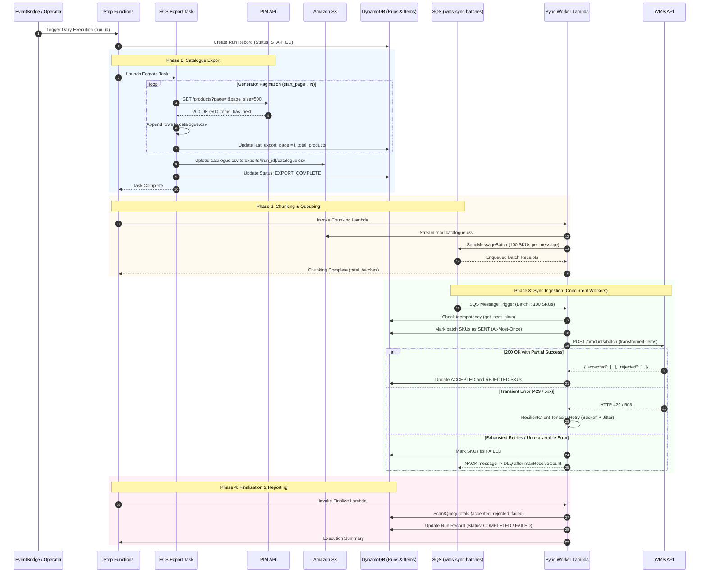
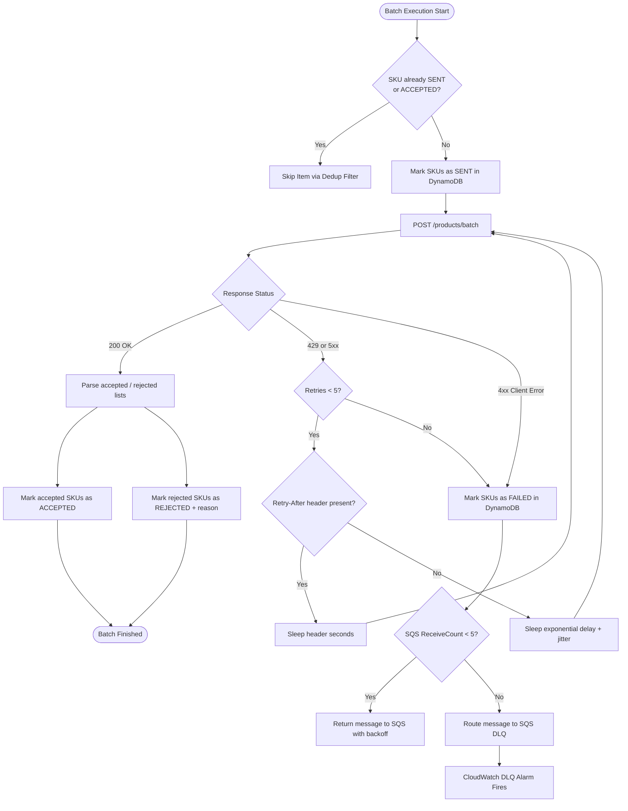

# Supply Chain Integration Platform — Architecture & Technical Design

## 1. Executive Summary

This document presents the target production architecture for the daily catalogue synchronisation pipeline between the **Product Information Management (PIM)** system and the **Warehouse Management System (WMS)**. 

### Business Context & Challenge
The integration synchronises the enterprise product catalogue from the central PIM into the operational WMS once daily. While initially designed for a small catalogue of under 10,000 items, the platform currently handles **250,000 products** and must scale to **1,000,000 products within 18 months**. 

The operational SLA requires the daily synchronisation to complete reliably within **30 minutes** without duplicating submissions or corrupting warehouse state. The external systems operate under strict rate constraints:
- **PIM API**: Paginated at 500 items/page, maximum 10 requests/second, variable latency (100 ms – 3 s), occasional HTTP 429/5xx errors.
- **WMS API**: Ingestion batches of ≤100 items/batch, maximum 20 requests/second, variable latency, partial record rejections (accepted vs. rejected lists), occasional HTTP 429/5xx errors.
- **Warehouse Mandate**: *"The same product must never be sent twice."*

### Architecture Overview
The production architecture is built on AWS using an event-driven, decoupled execution model orchestrated by **AWS Step Functions**. It divides the synchronisation lifecycle into four well-isolated phases:
1. **Export Phase (ECS Fargate Task)**: Iterates through the PIM API via generator-based streaming pagination, writing directly to a local CSV and uploading to Amazon S3 (`exports/{run_id}/catalogue.csv`) with zero in-memory accumulation.
2. **Chunking Phase (AWS Lambda)**: Reads the S3 CSV stream, maps products into batches of 100, and enqueues work items into an Amazon SQS queue.
3. **Sync Phase (AWS Lambda + Amazon SQS)**: Serverless workers pull batches from SQS, verify idempotency against Amazon DynamoDB, submit payloads to the WMS API governed by token-bucket rate limiters and exponential backoff, and record granular per-SKU outcomes.
4. **Finalize Phase (AWS Lambda)**: Aggregates execution counters, verifies Dead Letter Queue (DLQ) state, updates run records in DynamoDB, and emits CloudWatch operational metrics.

The codebase is engineered to run seamlessly in both **AWS production** (Step Functions, Fargate, Lambda, S3, SQS, DynamoDB, Secrets Manager) and **local development / CI** (local filesystem storage, in-memory state store, local Docker mock services).

---

## 2. System Architecture Diagram

The diagram below illustrates the end-to-end cloud infrastructure, component boundaries, execution flow, and storage tiers.

```mermaid
flowchart TD
    subgraph Trigger ["Scheduling & Orchestration"]
        EB["Amazon EventBridge (Daily Schedule Cron)"] -->|Starts Execution| SF["AWS Step Functions (State Machine)"]
    end

    subgraph Phase1 ["Phase 1: Catalogue Export (ECS Fargate)"]
        SF -->|Task 1: RunTask| Fargate["ECS Fargate Task (app.services.catalogue_export)"]
        PIM["External PIM API (10 req/s, 500/page)"] <-->|Paginated GET + API Key| Fargate
        Fargate -->|Checkpoints last_export_page| DDB_Runs[("DynamoDB: sync_runs")]
        Fargate -->|Stream CSV Upload| S3[("Amazon S3 Bucket: exports/{run_id}/catalogue.csv")]
    end

    subgraph Phase2 ["Phase 2: Chunking & Queuing (Lambda)"]
        SF -->|Task 2: Invoke| ChunkLambda["Chunking Lambda (app.services.chunking)"]
        S3 -->|Read CSV Stream| ChunkLambda
        ChunkLambda -->|Enqueue Batches of 100| SQS["Amazon SQS Queue: wms-sync-batches"]
        SQS -.->|Failed Batches after 5 retries| DLQ["Amazon SQS DLQ: wms-sync-batches-dlq"]
    end

    subgraph Phase3 ["Phase 3: Batch Ingestion (Lambda + SQS)"]
        SQS -->|Event Source Mapping (Concurrency Limit: 20)| SyncLambda["Sync Worker Lambdas (app.services.warehouse_sync)"]
        SyncLambda <-->|Pre-Check & Mark SENT| DDB_Items[("DynamoDB: sync_items")]
        SyncLambda <-->|POST /products/batch (20 req/s)| WMS["External WMS API (100 items/batch)"]
        SyncLambda -->|Update ACCEPTED / REJECTED / FAILED| DDB_Items
    end

    subgraph Phase4 ["Phase 4: Finalization & Metrics (Lambda)"]
        SF -->|Task 3: Invoke when SQS Empty| FinalLambda["Finalize Lambda (app.main.finalize)"]
        DDB_Items -->|Query Summary Counts| FinalLambda
        FinalLambda -->|Set Final Run Status| DDB_Runs
        FinalLambda -->|Emit Custom Metrics| CW["Amazon CloudWatch (Metrics & Alarms)"]
    end

    subgraph SecurityObservability ["Cross-Cutting Infrastructure"]
        SM["AWS Secrets Manager (API Keys)"] -.->|Injected Env Vars| Fargate
        SM -.->|Injected Env Vars| SyncLambda
        CW_Logs["CloudWatch Logs (structlog JSON)"] --- Fargate
        CW_Logs --- SyncLambda
        CW_Logs --- SF
    end

    classDef aws fill:#FF9900,stroke:#232F3E,stroke-width:2px,color:#232F3E;
    classDef storage fill:#3B48CC,stroke:#232F3E,stroke-width:2px,color:#FFFFFF;
    classDef external fill:#8C9BA5,stroke:#232F3E,stroke-width:2px,color:#232F3E;
    classDef lambda fill:#ED7100,stroke:#232F3E,stroke-width:2px,color:#FFFFFF;
    
    class SF,Fargate,ChunkLambda,SyncLambda,FinalLambda aws;
    class S3,DDB_Runs,DDB_Items,SQS,DLQ storage;
    class PIM,WMS external;
```

---

## 3. Major Components

The system cleanly separates infrastructural cloud services from reusable, testable Python domain components.

### 3.1 Cloud Infrastructure Services
- **AWS Step Functions**: Coordinates state transitions across export, chunking, sync, and finalization phases. Provides visual progress tracking, timeouts, automated retries for transient task errors, and error handling branches.
- **Amazon ECS on AWS Fargate**: Executes the long-running PIM catalogue export task. Fargate eliminates the 15-minute execution limit of Lambda, runs inside a private VPC subnet, and accesses the internet through an AWS NAT Gateway.
- **Amazon S3**: Acts as the immutable staging area. S3 stores `exports/{run_id}/catalogue.csv` under a 90-day lifecycle expiration rule with default server-side encryption (SSE-S3/KMS).
- **Amazon SQS & Dead Letter Queue (DLQ)**: Buffers WMS batch messages (`wms-sync-batches`). Decouples catalogue generation from WMS ingestion, enables horizontal fan-out, and captures poison messages in `wms-sync-batches-dlq` after 5 failed attempts.
- **AWS Lambda**:
  - *Chunking Lambda*: Reads the exported CSV from S3, partitions SKUs into chunks of 100, and enqueues messages using SQS `SendMessageBatch`.
  - *Sync Worker Lambda*: Processes batches from SQS, checks DynamoDB idempotency, invokes the WMS API, and updates item records.
  - *Finalize Lambda*: Aggregates counts, inspects DLQ depth, transitions run state, and issues CloudWatch alarms if rejections or failures breach thresholds.
- **Amazon DynamoDB**: Provides millisecond-latency state and idempotency tracking across two tables: [`sync_runs`](file:///Users/nirupma/git/takehomechallenge/app/storage/state.py#L7-L9) and [`sync_items`](file:///Users/nirupma/git/takehomechallenge/app/storage/state.py#L10-L13).
- **AWS Secrets Manager**: Securely stores API keys (`PRODUCT_API_KEY`, `WAREHOUSE_API_KEY`) and rotates credentials without redeploying application code.

### 3.2 Python Software Components
The core application code located in [`app/`](file:///Users/nirupma/git/takehomechallenge/app/) is structured into decoupled modules:

- **[`ResilientClient`](file:///Users/nirupma/git/takehomechallenge/app/clients/__init__.py#L97-L227)**: An enterprise HTTP wrapper built on `httpx`.
  - Integrates [`TokenBucketRateLimiter`](file:///Users/nirupma/git/takehomechallenge/app/clients/__init__.py#L55-L95) to enforce client-side request pacing (10 req/s for PIM, 20 req/s for WMS).
  - Implements exponential backoff with full jitter using `tenacity` on transient status codes (`429`, `500`, `502`, `503`, `504`).
  - Automatically parses and respects HTTP `Retry-After` response headers.
  - Distinguishes [`TransientAPIError`](file:///Users/nirupma/git/takehomechallenge/app/clients/__init__.py#L36-L44) from unrecoverable [`PermanentAPIError`](file:///Users/nirupma/git/takehomechallenge/app/clients/__init__.py#L46-L53) (e.g., 401 Unauthorized, 403 Forbidden, 422 Unprocessable).

- **[`ProductAPIClient`](file:///Users/nirupma/git/takehomechallenge/app/clients/product_api.py#L25-L106)**: Client for PIM catalogue extraction.
  - Implements generator-based streaming pagination via [`fetch_pages`](file:///Users/nirupma/git/takehomechallenge/app/clients/product_api.py#L39-L88).
  - Supports interrupted export resumption by accepting an optional `start_page` parameter.

- **[`WarehouseAPIClient`](file:///Users/nirupma/git/takehomechallenge/app/clients/warehouse_api.py#L42-L131)**: Client for WMS batch ingestion.
  - Transmits product batches (up to 100 items) via `POST /products/batch`.
  - Parses mixed success responses into structured [`BatchResult`](file:///Users/nirupma/git/takehomechallenge/app/clients/warehouse_api.py#L24-L40) objects containing distinct `accepted` and `rejected` lists.

- **[`S3Storage`](file:///Users/nirupma/git/takehomechallenge/app/storage/s3.py#L27-L102)**: Abstract storage adapter.
  - AWS Mode: Uses `boto3` to stream and persist CSV exports to S3 buckets.
  - Local Dev Mode: Stores artifacts in `./runtime/exports/` using identical key hierarchies, allowing full local execution without cloud emulators.

- **[`StateStore`](file:///Users/nirupma/git/takehomechallenge/app/storage/state.py#L73-L277)**: State management and idempotency engine.
  - Persists [`RunRecord`](file:///Users/nirupma/git/takehomechallenge/app/storage/state.py#L56-L71) with phase states defined by [`RunStatus`](file:///Users/nirupma/git/takehomechallenge/app/storage/state.py#L35-L44).
  - Tracks individual SKU lifecycle defined by [`ItemStatus`](file:///Users/nirupma/git/takehomechallenge/app/storage/state.py#L46-L54) (`PENDING`, `SENT`, `ACCEPTED`, `REJECTED`, `FAILED`).
  - Supports `--resume <run_id>` by retrieving the last completed checkpoint.

- **[`export_catalogue`](file:///Users/nirupma/git/takehomechallenge/app/services/catalogue_export.py#L35-L124)**: Service orchestrating page-by-page streaming write from PIM to CSV and uploading to S3 upon completion.

- **[`sync_catalogue`](file:///Users/nirupma/git/takehomechallenge/app/services/warehouse_sync.py#L90-L274)**: Service orchestrating CSV download, product transformation via [`transform`](file:///Users/nirupma/git/takehomechallenge/app/services/warehouse_sync.py#L65-L82), batch chunking via [`_chunk`](file:///Users/nirupma/git/takehomechallenge/app/services/warehouse_sync.py#L84-L88), deduplication, and concurrent batch delivery.

---

## 4. Execution Flow

The end-to-end execution lifecycle progresses through four deterministic phases.



### Detailed Phase Operations

#### Phase 0: Initialization
- EventBridge initiates execution on a daily cron schedule (e.g., `cron(0 2 * * ? *)` at 02:00 UTC).
- A unique run identifier is generated using [`generate_run_id()`](file:///Users/nirupma/git/takehomechallenge/app/main.py#L38-L46) formatted as `YYYYMMDD-HHMMSS-<short_uuid>` (e.g., `20261014-020000-a1b2c3d4`).
- An initial run entry is written to DynamoDB `sync_runs` with `status = "STARTED"` and `started_at = <timestamp>`.

#### Phase 1: Export Phase (ECS Fargate)
- ECS Fargate task starts with container environment variables containing `run_id`, AWS configuration, and Secrets Manager references.
- [`ProductAPIClient`](file:///Users/nirupma/git/takehomechallenge/app/clients/product_api.py#L25) requests pages sequentially starting at `start_page=1` (or page $N+1$ if resuming).
- The generator pattern streams 500 records at a time, writing each line immediately to a local CSV file.
- After each page write, DynamoDB `sync_runs` is updated with `last_export_page` and running `total_products`.
- Upon reaching `has_next == False`, the task uploads the CSV file to S3 at `exports/{run_id}/catalogue.csv`.
- The run status transitions to `EXPORT_COMPLETE`.

#### Phase 2: Chunking Phase (Lambda)
- Triggered by Step Functions once the export task finishes successfully.
- Reads `exports/{run_id}/catalogue.csv` from S3 as a stream using `boto3` `get_object()['Body']`.
- Transforms raw PIM CSV rows into the WMS data model via [`transform()`](file:///Users/nirupma/git/takehomechallenge/app/services/warehouse_sync.py#L65-L82).
- Collects products into chunks of 100 items and issues `SendMessageBatch` requests to Amazon SQS (`wms-sync-batches`).
- SQS message attributes include `run_id`, `batch_index`, and total batch count.

#### Phase 3: Sync Phase (Lambda Triggered by SQS)
- Lambda event source mapping consumes messages from SQS.
- Worker concurrency is capped at **20 concurrent executions** (matching the 20 req/s sustained WMS limit).
- For each batch:
  1. The worker inspects DynamoDB `sync_items` to check if any SKU in the batch was already processed in this run.
  2. Products not yet processed are atomically marked as `status = "SENT"` in DynamoDB.
  3. The batch is submitted to the WMS API via `POST /products/batch`.
  4. The response is parsed: accepted SKUs are marked `ACCEPTED`, while rejected records are marked `REJECTED` along with the validation error reason.
  5. If the request fails after 5 retries, the SKUs are marked `FAILED`, and the SQS message is returned to the queue (eventually landing in the DLQ).

#### Phase 4: Finalize & Reporting Phase (Lambda)
- Step Functions detects when the SQS queue and in-flight messages reach zero.
- The Finalize Lambda aggregates counters from DynamoDB: `total_accepted`, `total_rejected`, and `total_failed`.
- Inspects the DLQ for any dead-lettered batches.
- If `total_failed == 0`, run status becomes `COMPLETED`; otherwise, it is marked `FAILED`.
- Structured summary metrics are dispatched to Amazon CloudWatch.

---

## 5. Data Flow & Storage Design

### 5.1 Data Transformation Pipeline
Data flows through three distinct schema representations:

```
[ PIM API Response (JSON) ]
          │
          ▼
[ S3 Intermediate Staging (CSV) ]
          │
          ▼
[ WMS Ingestion Payload (JSON) ]
```

#### 1. PIM API Schema (Source)
```json
{
  "id": "SKU-100234",
  "name": "Heavy Duty Industrial Widget",
  "category": "HARDWARE",
  "price": 49.99,
  "currency": "GBP",
  "updated_at": "2026-10-14T01:30:00Z"
}
```

#### 2. S3 Staging Format (CSV)
Retained for 90 days for audit and reconciliation:
```csv
id,name,category,price,currency,updated_at
SKU-100234,Heavy Duty Industrial Widget,HARDWARE,49.99,GBP,2026-10-14T01:30:00Z
```

#### 3. WMS Ingestion Format (Target)
Transformed via [`transform()`](file:///Users/nirupma/git/takehomechallenge/app/services/warehouse_sync.py#L65-L82):
```json
{
  "sku": "SKU-100234",
  "description": "Heavy Duty Industrial Widget",
  "selling_price": 49.99,
  "currency": "GBP",
  "category_code": "HARDWARE",
  "source_updated_at": "2026-10-14T01:30:00Z"
}
```

### 5.2 DynamoDB Schema Design

#### Table 1: `sync_runs`
Tracks coarse-grained operational run state, progression, and timing.

| Attribute | Type | Description |
| :--- | :--- | :--- |
| `run_id` (**PK**) | String | Time-sortable run ID (`YYYYMMDD-HHMMSS-<uuid>`) |
| `status` | String | Current state (`STARTED`, `EXPORTING`, `EXPORT_COMPLETE`, `SYNCING`, `COMPLETED`, `FAILED`) |
| `started_at` | Number (Epoch) | Epoch timestamp when the run began |
| `completed_at` | Number (Epoch) | Epoch timestamp when the run finished |
| `s3_key` | String | Path to catalogue file in S3 (`exports/{run_id}/catalogue.csv`) |
| `total_products` | Number | Total records exported from PIM |
| `total_accepted` | Number | Count of records successfully accepted by WMS |
| `total_rejected` | Number | Count of records rejected by WMS validation |
| `total_failed` | Number | Count of records that encountered fatal delivery errors |
| `last_export_page` | Number | Checkpoint page index during PIM pagination |
| `error` | String | Top-level error message if run failed |

#### Table 2: `sync_items`
Tracks granular per-product state to guarantee at-most-once delivery within a run.

| Attribute | Type | Description |
| :--- | :--- | :--- |
| `run_sku` (**PK**) | String | Composite key: `{run_id}#{sku}` (ensures per-run item isolation) |
| `run_id` (**GSI PK**) | String | Run identifier (allows querying all items for a given run) |
| `sku` | String | Product SKU |
| `status` | String | Item state (`PENDING`, `SENT`, `ACCEPTED`, `REJECTED`, `FAILED`) |
| `batch_index` | Number | Index of the batch containing this SKU |
| `reason` | String | Rejection explanation or error message from WMS |
| `updated_at` | Number (Epoch) | Epoch timestamp of last state transition |

*Index*: Global Secondary Index `GSI_run_status` with Partition Key `run_id` and Sort Key `status` allows efficient status counting and deduplication lookups.

### 5.3 Amazon S3 Retention & Lifecycle Policy
- **Prefix Path**: `s3://catalogue-exports/exports/{run_id}/catalogue.csv`
- **Lifecycle Rule**:
  - Transition to `S3 Standard-Infrequent Access (Standard-IA)` after 30 days.
  - Permanent expiration / deletion after **90 days** (satisfying the audit requirement).
  - Abort incomplete multipart uploads after 7 days.
- **Encryption**: Enforce SSE-S3 (`AES256`) or SSE-KMS at rest via bucket policy.

---

## 6. Failure & Retry Flow

Production distributed systems must anticipate failures at every integration boundary.



### 6.1 Resilience Strategies by Layer

#### 1. HTTP Resilience ([`ResilientClient`](file:///Users/nirupma/git/takehomechallenge/app/clients/__init__.py#L97))
- **Status Classification**:
  - *Transient*: `429 Too Many Requests`, `500 Internal Server Error`, `502 Bad Gateway`, `503 Service Unavailable`, `504 Gateway Timeout`.
  - *Permanent*: `400 Bad Request`, `401 Unauthorized`, `403 Forbidden`, `404 Not Found`, `422 Unprocessable Entity`.
- **Tenacity Exponential Backoff with Full Jitter**:
  $$\text{Delay} = \min(\text{MaxDelay}, \text{BaseDelay} \times 2^{\text{attempt}}) \pm \text{RandomJitter}$$
  - Default parameters: `base_delay = 1.0s`, `max_delay = 60.0s`, `max_retries = 5`.
  - Full jitter prevents synchronized thundering herds against external systems during API recovery.
- **`Retry-After` Header Adherence**:
  If an upstream service responds with `Retry-After: 12`, the client respects this value explicitly rather than calculating an arbitrary backoff.

#### 2. Export Phase Resumption
If the ECS export task crashes midway (e.g., container host preemption, network partition at page 750 of 2000):
- Step Functions restarts the ECS task with the same `run_id` and the `--resume` flag.
- The task queries DynamoDB `sync_runs` to retrieve `last_export_page = 750`.
- The task opens `catalogue.csv` in append mode and resumes fetching from `start_page = 751`, avoiding duplicate fetches of pages 1 through 750.

#### 3. SQS Message Resilience & Dead Letter Queues
- SQS queue visibility timeout is configured to **6 times the Lambda function timeout** (e.g., 60s visibility timeout for a 10s Lambda execution).
- If a worker Lambda crashes unexpectedly before updating DynamoDB, the message reappears on the queue after the visibility timeout expires.
- After **5 unsuccessful attempts**, the message transitions to `wms-sync-batches-dlq`.
- Operational personnel can inspect failed batch payloads, resolve external system blockers, and redrive the DLQ back to the primary queue.

---

## 7. Scaling Approach & Performance Model (10K $\rightarrow$ 250K $\rightarrow$ 1M Products)

The business requirement mandates that the full daily catalogue synchronisation complete within **30 minutes (1,800 seconds)** across all volume tiers.

### 7.1 Quantitative Performance Model

#### PIM Export Phase Analysis
- **Constraint**: PIM API enforces a hard rate limit of **10 requests/second** and page size of **500 records**.
- **Nature**: Pagination must be evaluated sequentially to traverse pages ($page_1 \rightarrow page_2 \rightarrow \dots$).

$$\text{Pages to Fetch} = \frac{\text{Total Catalogue Size}}{500}$$
$$\text{Export Time (at 10 req/s)} = \frac{\text{Pages to Fetch}}{10 \text{ req/s}}$$

#### WMS Sync Phase Analysis
- **Constraint**: WMS API enforces a sustained rate limit of **20 requests/second** and batch size of **100 records**.
- **Nature**: Batches are completely independent and are submitted concurrently via SQS workers governed by rate limiting.

$$\text{Batches to Send} = \frac{\text{Total Catalogue Size}}{100}$$
$$\text{Sync Time (at 20 req/s sustained)} = \frac{\text{Batches to Send}}{20 \text{ req/s}}$$

### 7.2 Scalability Projection Table

| Catalogue Scale | PIM Pages (500/page) | Export Duration (at 10 req/s) | WMS Batches (100/batch) | Sync Duration (at 20 req/s) | Chunking & Overhead | **Total Runtime** | **30-Min SLA Margin** |
| :--- | :--- | :--- | :--- | :--- | :--- | :--- | :--- |
| **10,000** *(Baseline)* | 20 pages | **2 seconds** | 100 batches | **5 seconds** | ~3 seconds | **~10 seconds** | 99.4% buffer |
| **250,000** *(Current)* | 500 pages | **50 seconds** | 2,500 batches | **125 seconds** (~2.1 min) | ~15 seconds | **~3.2 minutes** | 89.3% buffer |
| **1,000,000** *(18 Months)* | 2,000 pages | **200 seconds** (~3.3 min) | 10,000 batches | **500 seconds** (~8.3 min) | ~30 seconds | **~12.1 minutes** | **59.7% buffer** |

> [!NOTE]
> Even at the 18-month target volume of **1,000,000 products**, the entire pipeline executes in approximately **12.1 minutes**. This leaves an operational buffer of nearly **18 minutes (60%)** to accommodate network jitter, transient 429 retries, and API response latency variations (100 ms – 3 s).

### 7.3 Memory Complexity Analysis
- In the original legacy implementation, retrieving all products into a Python list created an $O(N)$ memory footprint. At 1M products with JSON overhead, memory consumption would exceed 250 MB–500 MB in-memory, risking OOM kills.
- In this architecture, [`ProductAPIClient`](file:///Users/nirupma/git/takehomechallenge/app/clients/product_api.py#L25) is an $O(1)$ memory generator. Each page of 500 items is written immediately to disk and evicted from memory. Memory consumption remains constant at **< 50 MB** regardless of whether the catalogue contains 10K or 10M records.

---

## 8. API Rate Limit Handling

External API boundaries enforce distinct rate limits that must never be exceeded.

### 8.1 Token-Bucket Rate Limiter ([`TokenBucketRateLimiter`](file:///Users/nirupma/git/takehomechallenge/app/clients/__init__.py#L55-L95))
The client employs an in-process, thread-safe token-bucket algorithm:
- **Refill Rate ($\rho$)**: Tokens added per second ($\rho = 10$ for PIM, $\rho = 20$ for WMS).
- **Capacity ($C$)**: Maximum bucket capacity ($C = \text{int}(\rho)$).
- **Acquire Mechanism**: Before issuing any HTTP call, [`acquire()`](file:///Users/nirupma/git/takehomechallenge/app/clients/__init__.py#L79-L95) consumes 1 token. If the bucket is empty, the thread sleeps for $1 / \rho$ seconds to avoid CPU busy-waiting.

### 8.2 Distributed Serverless Rate Limiting
In AWS production, multiple Lambda workers process SQS messages simultaneously. To prevent 100 concurrent Lambdas from overwhelming the WMS API (exceeding 20 req/s):
1. **Lambda Reserved Concurrency**: The SQS event source mapping is configured with `maximum_concurrency = 20`.
2. **Batch Windowing**: Each Lambda worker processes 1 batch per invocation, taking ~200–500 ms per WMS round-trip.
3. **Queue Pacing**: Even under maximum queue depth, the concurrency throttle guarantees that the global request rate against WMS never exceeds the negotiated 20 req/s ceiling.

---

## 9. Handling Partial Failures

The WMS API specification states:
> *"Individual records can be rejected for business validation reasons. A successful request may therefore contain both accepted and rejected records."*

### 9.1 Split Response Processing
When WMS returns HTTP 200, the payload contains two lists:
```json
{
  "accepted": ["SKU-001", "SKU-002"],
  "rejected": [
    {"sku": "SKU-999", "reason": "Invalid category code"},
    {"sku": "SKU-100", "reason": "Negative selling price"}
  ]
}
```

The [`WarehouseAPIClient`](file:///Users/nirupma/git/takehomechallenge/app/clients/warehouse_api.py#L42) and [`sync_catalogue`](file:///Users/nirupma/git/takehomechallenge/app/services/warehouse_sync.py#L90) handle this deterministically:
1. **Granular Status Updates**:
   - Every SKU in `accepted` is marked in DynamoDB `sync_items` as `status = "ACCEPTED"`.
   - Every SKU in `rejected` is marked as `status = "REJECTED"` with the specific business reason recorded in the `reason` attribute.
2. **Fault Isolation**: A rejected item does **not** fail the batch or the pipeline. Valid items in the same batch are accepted and committed without rollback.
3. **Mock Behavior Awareness**: Products ending in "999" are known to trigger mock business rejections. These are captured in the run summary ([`rejected_details`](file:///Users/nirupma/git/takehomechallenge/app/services/warehouse_sync.py#L58)) and audited without causing overall run abortion.
4. **Failure Threshold Alarms**: If the proportion of rejected SKUs exceeds a configurable business threshold (e.g., > 5% of catalogue), a CloudWatch alarm alerts the supply chain operations team to investigate potential PIM data quality corruption.

---

## 10. Duplicate Handling & Idempotency ("Never Send Twice")

The warehouse team established the strict requirement:
> *"The same product must never be sent twice."*

### 10.1 Business vs. Technical Interpretation
To translate this requirement into a rigorous technical implementation, we differentiate two scopes:

1. **Intra-Run Scope (Strict At-Most-Once)**:
   Within a single daily sync run, no product SKU should ever be transmitted to the WMS more than once. If a batch experiences a transient network drop or worker crash, products that were already acknowledged or in-flight must not be duplicated.
2. **Inter-Run Scope (Daily Full Catalogue Sync)**:
   The business operates a daily full-catalogue sync. Products sent on Monday will be sent again on Tuesday with updated prices, descriptions, or inventory attributes. The WMS is expected to perform idempotent upserts based on `sku` across daily runs.

### 10.2 State-Machine Idempotency Protocol

To enforce the intra-run guarantee, [`sync_catalogue`](file:///Users/nirupma/git/takehomechallenge/app/services/warehouse_sync.py#L90) implements a two-phase check-and-mark state protocol backed by DynamoDB:

```
[ Unprocessed SKU ]
        │
        ▼
   ( Pre-Check )  ───> If status is SENT or ACCEPTED ───> [ Skip via Dedup ]
        │
        ▼
[ Mark as SENT ]  ───> At-Most-Once Fence Committed
        │
        ▼
 ( Call WMS API )
        │
   ┌────┴───────────────────────────┐
   ▼                                ▼
[ Success ]                    [ Failure ]
   │                                │
   ├─> Mark ACCEPTED                └─> Mark FAILED
   └─> Mark REJECTED (+ reason)
```

1. **Pre-Check**: Before dispatching batches, the orchestrator queries DynamoDB `sync_items` for any SKUs in the current run that have already reached `SENT` or `ACCEPTED` status. Any matching SKUs are stripped from the dispatch list.
2. **Pre-Transmission Fencing (`SENT`)**: The worker marks the batch's SKUs as `SENT` in DynamoDB **before** initiating the network call to the WMS API.
3. **Post-Transmission Resolution**:
   - If the call succeeds: Items transition to `ACCEPTED` or `REJECTED`.
   - If the worker crashes mid-flight: The items remain in `SENT` state. When the run is resumed or retried, the dedup check skips them, guaranteeing that the WMS will not receive duplicates.

> [!IMPORTANT]
> **At-Most-Once vs. At-Least-Once Justification**:
> In standard messaging architectures, at-least-once delivery is typical. However, because the WMS API does not support native idempotency keys (e.g., `Idempotency-Key: <token>`), and because the business rule explicitly prohibits duplicates, an **at-most-once** semantic within a run is strictly required. A crash between marking `SENT` and receiving the response results in an item marked as `SENT` (audited for manual operational replay) rather than risking duplicate ingestion in the warehouse.

---

## 11. AWS Service Choices & Justifications

The table below summarizes the architectural rationale for selecting each AWS service over alternative patterns.

| AWS Service | Selected For | Evaluated Alternative | Justification for Choice |
| :--- | :--- | :--- | :--- |
| **AWS Step Functions** | Workflow Orchestration | Apache Airflow / AWS MWAA, Cron script | Step Functions is fully managed, serverless, natively integrates with ECS/Lambda/SQS, requires zero cluster maintenance, and charges per state transition rather than idle compute. |
| **AWS Fargate (ECS)** | Catalogue Export Phase | AWS Lambda | PIM pagination is strictly sequential (10 req/s, 500/page). At 1M products, export takes ~3.3 minutes. Lambda's 15-minute hard timeout provides an uncomfortably narrow margin if PIM experiences latency spikes. Fargate has no execution timeout limits. |
| **Amazon S3** | Intermediate Storage | Direct streaming queue / memory buffer | Decouples PIM extraction from WMS ingestion. The CSV file serves as an immutable, audited snapshot of the catalogue retained for 90 days as mandated by business compliance. |
| **Amazon SQS + Lambda** | Batch Chunking & Sync | Long-running ECS Worker cluster | SQS provides elastic buffering, automatic dead-letter queue routing, and fine-grained per-batch retries. Lambda automatically scales compute up and down with zero idle cost. |
| **Amazon DynamoDB** | State & Idempotency Store | Amazon RDS (PostgreSQL / Aurora) | The access pattern is exclusively key-value lookups by `run_id` and `{run_id}#{sku}`. DynamoDB offers single-digit millisecond latency, on-demand capacity auto-scaling, and zero connection-pooling bottlenecks. |
| **AWS Secrets Manager** | Secret Storage | Environment variables in plaintext / Parameter Store | Secrets Manager provides centralized secret encryption (KMS), automated secret rotation, and strict IAM authorization policies. |

---

## 12. Security & IAM Considerations

The platform adheres to the AWS Well-Architected Framework for security and least privilege.

```mermaid
flowchart LR
    subgraph VPC ["Private VPC (10.0.0.0/16)"]
        subgraph PrivateSubnet ["Private Subnets"]
            ECS["ECS Fargate Task"]
            Lambda["Lambda Workers"]
        end
        subgraph PublicSubnet ["Public Subnets"]
            NAT["NAT Gateway"]
            IGW["Internet Gateway"]
        end
        VPC_Endpoints["VPC Endpoints (S3, DDB, SQS, Secrets)"]
    end

    PrivateSubnet -->|AWS Internal Traffic| VPC_Endpoints
    PrivateSubnet -->|External API Traffic| NAT --> IGW
    IGW -->|Egress HTTPS (443)| ExtAPIs["PIM & WMS APIs"]
```

### 12.1 Network Topology & Isolation
- **Private Subnets**: All ECS tasks and Lambda functions reside within private subnets without public IPv4 addresses.
- **Egress Routing**: Outbound traffic to the external PIM and WMS APIs routes through AWS NAT Gateways over encrypted HTTPS (TLS 1.3).
- **VPC Endpoints (AWS PrivateLink)**: AWS service communication (S3, DynamoDB, SQS, Secrets Manager, CloudWatch) routes privately through Gateway and Interface Endpoints, never traversing the public internet.

### 12.2 IAM Least-Privilege Roles
Each pipeline stage executes under an isolated IAM role with strictly scoped policies:

1. **`CatalogueExportTaskRole` (ECS Fargate)**:
   - `s3:PutObject` restricted to `arn:aws:s3:::catalogue-exports/exports/*`
   - `dynamodb:UpdateItem`, `dynamodb:PutItem` restricted to `sync_runs`
   - `secretsmanager:GetSecretValue` restricted to PIM API key secret
2. **`ChunkingLambdaRole`**:
   - `s3:GetObject` restricted to `arn:aws:s3:::catalogue-exports/exports/*`
   - `sqs:SendMessage`, `sqs:SendMessageBatch` on `wms-sync-batches`
3. **`SyncWorkerLambdaRole`**:
   - `sqs:ReceiveMessage`, `sqs:DeleteMessage`, `sqs:GetQueueAttributes` on `wms-sync-batches`
   - `dynamodb:GetItem`, `dynamodb:PutItem`, `dynamodb:UpdateItem` on `sync_items`
   - `secretsmanager:GetSecretValue` restricted to WMS API key secret
4. **`StepFunctionsExecutionRole`**:
   - Permissions to invoke ECS tasks, Lambda functions, and read execution state.

### 12.3 Data Encryption
- **In Transit**: All HTTP traffic is strictly HTTPS with TLS 1.2+ enforced.
- **At Rest**:
  - S3 bucket encrypted with AES-256 (`aws:kms` or `SSE-S3`).
  - DynamoDB tables encrypted with AWS managed KMS keys.
  - SQS queues encrypted with KMS.

---

## 13. Observability Considerations

Enterprise integrations require deep observability for operational diagnostics and automated alerting.

### 13.1 Structured JSON Logging
All application logging is standardized using `structlog` to emit structured JSON logs to CloudWatch Logs:
```json
{
  "timestamp": "2026-10-14T02:04:15.123Z",
  "level": "info",
  "logger": "app.services.warehouse_sync",
  "run_id": "20261014-020000-a1b2c3d4",
  "batch_index": 42,
  "accepted_count": 98,
  "rejected_count": 2,
  "duration_ms": 234.5,
  "event": "wms_batch_partial_reject"
}
```
Binding `run_id` as a context variable across all execution layers allows complete end-to-end trace correlation in CloudWatch Logs Insights:
```sql
fields @timestamp, level, event, batch_index, accepted_count, rejected_count
| filter run_id = "20261014-020000-a1b2c3d4"
| sort @timestamp desc
```

### 13.2 Custom CloudWatch Metrics
The finalization Lambda and worker components emit custom metrics into the `SupplyChain/CatalogueSync` namespace:

| Metric Name | Unit | Dimensions | Description |
| :--- | :--- | :--- | :--- |
| `CatalogueSyncDuration` | Seconds | `RunId` | Total elapsed pipeline execution duration |
| `ExportPhaseDuration` | Seconds | `RunId` | Duration of PIM extraction phase |
| `ProductsExported` | Count | `RunId` | Total products extracted from PIM |
| `ProductsAccepted` | Count | `RunId` | Total products accepted by WMS |
| `ProductsRejected` | Count | `RunId`, `Category` | Products rejected by WMS validation |
| `ProductsFailed` | Count | `RunId` | Products failing delivery after all retries |
| `WMSRateLimitThrottles` | Count | `RunId` | HTTP 429 events encountered |

### 13.3 CloudWatch Alarms & Operational Alerting
- **Alarm: Pipeline SLA Breach Risk**: Triggers if Step Functions execution duration exceeds **25 minutes** (5 minutes prior to 30-minute SLA threshold).
- **Alarm: SQS Dead Letter Queue Depth**: Triggers if `ApproximateNumberOfMessagesVisible > 0` on `wms-sync-batches-dlq`.
- **Alarm: High Rejection Rate**: Triggers if `ProductsRejected / ProductsExported > 0.05` (more than 5% rejected).
- **Alarm: Run Failure**: Triggers immediately on any Step Functions `FAILED` state execution.
- All alarms publish to an Amazon SNS topic connected to the on-call PagerDuty / Slack operational channel.

---

## 14. Important Trade-offs

Architecture is the art of choosing the right set of trade-offs. The following decisions were deliberately made:

| # | Architecture Decision | Trade-Off Chosen | Alternative Considered | Engineering Rationale |
| :-: | :--- | :--- | :--- | :--- |
| **1** | **ECS Fargate vs. Lambda for Export** | Dedicated container execution overhead vs. Execution duration safety | Lambda for export | Lambda has a 15-minute timeout. At 1M items with 10 req/s pagination, export takes ~3.3 minutes under ideal conditions. If PIM experiences degraded latency (1–3s per page), Lambda can breach the timeout. Fargate has no timeout, ensuring total operational safety. |
| **2** | **SQS + Lambda vs. ECS for Sync** | Serverless micro-billing & auto-scaling vs. Fixed persistent workers | ECS Fargate worker pool | SQS + Lambda provides instant horizontal concurrency scaling (up to the 20 worker cap) and built-in per-batch retry/DLQ capabilities. Managing an ECS cluster requires auto-scaling policies, task provisioning latency, and paying for idle capacity. |
| **3** | **DynamoDB vs. Relational RDS** | Schemaless key-value access vs. Complex SQL reporting | Amazon Aurora PostgreSQL | State tracking only requires point lookups (`run_id`, `{run_id}#{sku}`). DynamoDB has predictable single-digit millisecond latency, scales automatically, requires no connection pooler (RDS Proxy), and costs pennies for on-demand read/writes. |
| **4** | **At-Most-Once vs. At-Least-Once Semantics** | Risk of dropped item requiring replay vs. Risk of duplicate ingestion | At-Least-Once with replay | The WMS API lacks idempotency key support, and the business rule explicitly states: *"The same product must never be sent twice."* At-most-once guarantees that transient worker failures will never corrupt warehouse stock records with duplicates. |
| **5** | **Full Daily Catalogue Sync vs. Delta / CDC Sync** | Higher network payload per day vs. Complete synchronization certainty | Delta sync via updated_at filter | The PIM API does not provide a change data capture (CDC) endpoint or reliable webhook mechanism. Attempting delta sync based on client timestamps risks missing out-of-order updates or deleted products. Full sync guarantees 100% catalogue consistency every 24 hours. |
| **6** | **S3 Staging File vs. Direct Pipeline Streaming** | Temporary S3 storage cost vs. Pipeline decoupling & auditability | Direct streaming from PIM to SQS | Staging the CSV in S3 creates an immutable, historical snapshot of the exact catalogue as exported each day. It satisfies the 90-day compliance retention requirement and allows re-syncing without hitting the PIM API again. |

---

## 15. Requirements Clarification & Assumptions Framework

In accordance with Section 7 of the engineering challenge specification, this section formally documents the identified issues, assumptions made, their system effects, and alternate architectural designs if the assumptions are invalid.

### Assumption 1: Scope of "Never Send Twice"
1. **Issue Identified**: The Warehouse team states: *"The same product must never be sent twice."* However, the company runs a daily synchronisation of the full catalogue. If interpreted globally across all time, products could only ever be sent on their first day of existence, preventing updates to prices, categories, or descriptions.
2. **Assumption Made**: We assume "never send twice" applies **strictly within the boundary of a single daily run** (intra-run idempotency). Across subsequent daily runs, the full catalogue is sent, and the WMS is assumed to handle upserts (idempotent record updates) on duplicate SKUs.
3. **Effect of Assumption**: The system implements an intra-run dedup check in DynamoDB (`sync_items`), marking products as `SENT` before invoking WMS. Daily runs process the full 250K / 1M catalogue.
4. **If Assumption Were Invalid**: If the WMS cannot accept already-known SKUs even across different days, we would redesign the state store to maintain a global `catalogue_inventory` DynamoDB table storing each SKU's content hash (`hash(price, name, category)`). The integration would only transmit SKUs whose content hash changed since the previous day (a client-side delta sync).

### Assumption 2: Business Rejections vs. System Failures
1. **Issue Identified**: The mock WMS service consistently rejects products ending in "999" (and other validation errors), returning them in the `rejected` array.
2. **Assumption Made**: We assume individual record validation rejections are expected business domain outcomes (e.g., malformed PIM data) rather than pipeline infrastructure failures.
3. **Effect of Assumption**: The sync worker logs rejections, marks them as `REJECTED` in DynamoDB, records the rejection reason, and continues processing the remainder of the catalogue. The pipeline status remains `COMPLETED` unless fatal delivery errors or unexpected system exceptions occur.
4. **If Assumption Were Invalid**: If any single SKU rejection is considered a fatal operational breach, the finalize phase would transition the run to `FAILED`, and Step Functions would trigger an immediate rollback or alert the warehouse team before committing inventory.

### Assumption 3: PIM Catalogue Stability & Total Consistency
1. **Issue Identified**: The PIM API is paginated and returns a `total` field on each page. In production, items could theoretically be inserted or deleted during the 3.3-minute export window.
2. **Assumption Made**: We assume the PIM catalogue is sufficiently stable during the daily scheduled run window (e.g., scheduled during off-peak hours at 02:00 AM) such that pagination drift does not result in duplicate or omitted records.
3. **Effect of Assumption**: Standard sequential page traversal (`page=1, 2, ...`) is utilized without requiring a database snapshot lock or cursor-based pagination.
4. **If Assumption Were Invalid**: If real-time writes cause pagination drift, we would require the PIM team to provide cursor-based pagination (e.g., `keyset` pagination using `after_id=SKU-xyz`) or generate a point-in-time snapshot export.

### Assumption 4: 30-Minute SLA Scope
1. **Issue Identified**: The business expects the daily synchronisation to complete within 30 minutes.
2. **Assumption Made**: We assume the 30-minute SLA encompasses the **entire end-to-end pipeline**, starting from EventBridge trigger, through ECS export, S3 staging, SQS chunking, WMS ingestion, and DynamoDB finalization.
3. **Effect of Assumption**: Throughput budgets were allocated accordingly: ~3.3 minutes for export, ~0.5 minutes for chunking, and ~8.3 minutes for sync at 1M products, resulting in a total runtime of ~12.1 minutes (well within 30 minutes).
4. **If Assumption Were Invalid**: If the SLA only applied to the WMS ingestion phase, the operational safety margin would be even wider (8.3 minutes vs. 30 minutes).

### Assumption 5: WMS API Lack of Idempotency Key Header
1. **Issue Identified**: The WMS API documentation does not mention an `Idempotency-Key` or request transaction header.
2. **Assumption Made**: We assume the WMS API does not natively deduplicate identical POST payloads sent with the same transaction token.
3. **Effect of Assumption**: The client-side architecture enforces strict at-most-once semantics by marking SKUs as `SENT` before issuing the HTTP call.
4. **If Assumption Were Invalid**: If the WMS API supported native idempotency keys (e.g., `X-Idempotency-Key: {run_id}-{batch_index}`), we could safely adopt at-least-once retries at the network layer without risking duplicate processing in the warehouse.
